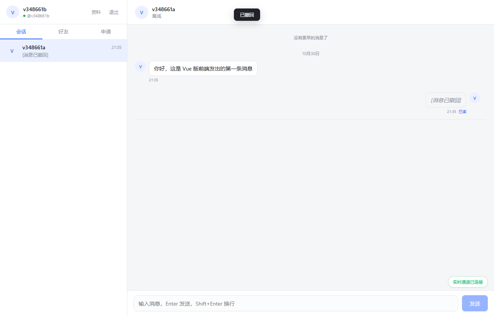
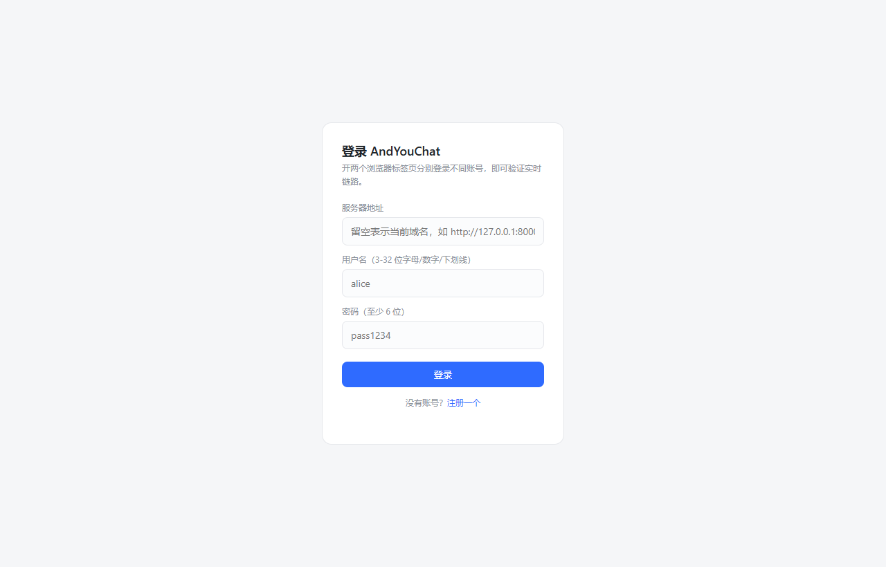

# AndYouChat

> 自建私聊系统 ｜ FastAPI + WebSocket + Redis + MySQL ｜ Vue 3 全端响应式 Web 客户端

一套可从零跑起来、也已在云服务器上稳定运行的即时通讯（IM）系统。后端是异步 FastAPI，实时链路走 WebSocket + Redis Pub/Sub，前端是 Vue 3 单页应用，桌面 / 平板 / 手机三档响应式。当前版本 **v1.0.0**，已完成账号体系、好友关系、单聊实时消息的完整闭环。

<p>
  
  
  
  
  
  
</p>



<p align="center"><i>桌面端双栏视图：左侧会话 / 好友 / 申请，右侧全屏聊天</i></p>



<p align="center"><i>登录页：用户名 + 密码，无需手机号与短信</i></p>

---

## 一、项目简介

AndYouChat 是一个**完全自建、不依赖第三方 IM 服务**的私聊系统，适合企业内部沟通、小团队协作或作为 IM 技术方案的学习样本。设计原则是「先简单、后可扩展」：

- 账号密码注册登录，不依赖手机号 / 短信，部署即用
- 好友制：必须先互为好友才能发起会话，无陌生人骚扰
- 消息以**会话内自增 seq** 为唯一同步基准，不用时间戳排序，断线补拉天然准确
- 单进程即可跑（SQLite + fakeredis），生产切 MySQL 8 + Redis 7 **无需改一行代码**
- 前端全端兼容：桌面双栏、手机单栏切换，旧版手机浏览器可用

## 二、功能清单（v1.0.0）

| 模块 | 能力 |
|---|---|
| 账号 | 用户名 + 密码注册 / 登录、JWT（access 7 天 / refresh 30 天）、bcrypt 密码哈希、昵称与签名修改 |
| 好友 | 用户搜索、发起申请、同意 / 拒绝、好友列表、双向申请自动成好友、重复申请幂等 |
| 会话 | 单聊会话唯一（A↔B 只有一个）、会话列表（最后消息 / 未读 / 时间）、未读计数、已读游标 |
| 消息 | 文本消息、会话内 seq 单调自增、`client_msg_id` 幂等、历史分页、`after_seq` 增量补拉、2 分钟内撤回 |
| 实时 | WebSocket 收发、ack 回执、已读回执、正在输入、在线状态、25s 心跳 + 指数退避重连 |
| 前端 | 登录 / 注册、会话 / 好友 / 申请三页签、聊天气泡与状态、乐观发送与失败重发、消息撤回、资料编辑 |
| 适配 | ≥1025px 双栏、769–1024px 收窄双栏、≤768px 单栏切换（列表 ↔ 聊天，带返回） |
| 运维 | 一键部署脚本（Docker Compose + systemd + Nginx）、健康检查、数据库/Redis 密码自动生成 |

## 三、技术栈

| 层 | 选型 | 说明 |
|---|---|---|
| 后端 | FastAPI + Uvicorn | 全异步，`async/await` 到底 |
| ORM | SQLAlchemy 2.0 async | 2.0 风格声明式模型 |
| 校验 | Pydantic v2 | 响应模型 + 中文化错误信息 |
| 数据库 | MySQL 8.0 / SQLite | 生产 MySQL，本地 SQLite 零依赖 |
| 缓存 / 广播 | Redis 7 / fakeredis | seq 分配、Pub/Sub 跨进程广播 |
| 实时 | 原生 WebSocket | 不引第三方 socket 库，协议自己控 |
| 前端 | Vue 3 + Vite 8 | 原生组件，无 UI 框架，样式手写 |
| 部署 | Docker Compose + systemd + Nginx | 容器只跑 MySQL/Redis，应用走 systemd |

## 四、系统架构

```
                    ┌────────────┐   HTTPS   ┌──────────────┐
   浏览器 / 手机 ───▶│   Nginx    │──────────▶│  /chat/ 静态  │  Vue 3 产物
                    │  80 / 443  │           └──────────────┘
                    │            │  /chat/api/  ──▶ 127.0.0.1:8200  FastAPI
                    │            │  /chat/ws    ──▶ WebSocket 升级
                    └────────────┘
                                        │
                              ┌─────────┴─────────┐
                              ▼                   ▼
                      ┌──────────────┐   ┌──────────────┐
                      │ MySQL 8.0    │   │ Redis 7      │
                      │ users / 好友  │   │ seq 计数      │
                      │ 会话 / 消息   │   │ Pub/Sub 广播  │
                      └──────────────┘   └──────────────┘
```

**消息投递链路**：落库 → 本地连接直发（发送方收到 ack）→ Redis Pub/Sub 广播 → 其他 worker 进程按 `_origin` 去重后推给接收方。单进程运行时 Pub/Sub 这一跳不会产生重复，多进程扩容无需改代码。

## 五、目录结构

```
app/
  main.py                 应用装配、lifespan、静态资源与根路径跳转
  core/                   config / security(JWT+bcrypt) / snowflake / redis / errors
  db/                     Base / engine / session / init_db
  models/                 User, Friendship, FriendRequest, Conversation,
                          ConversationMember, Message
  schemas/                Pydantic 请求响应模型
  services/               业务逻辑（user / friend / conversation / message）
  api/v1/                 REST 路由 + ws.py
  ws/                     连接管理、事件协议、Redis 订阅
web/                      Vue 3 + Vite 前端源码
chat/                     前端构建产物（npm run build:chat，Nginx 托管 /chat/）
static/chat.html          单文件网页调试台（双标签页互测）
tests/                    pytest（41 项）
scripts/                  smoke_test.py / e2e_web.js / e2e_stability.js
deploy/                   一键部署（install.sh、compose、service、nginx、schema.sql、pack.sh）
docs/                     DEPLOY.md / PROTOCOL.md / TEST-TASKS.md / 截图
```

## 六、本地运行

本地默认**零外部依赖**：SQLite + fakeredis，装完依赖直接能跑。

```bash
# 1. 依赖
python -m venv .venv
./.venv/Scripts/python.exe -m pip install -r requirements.txt   # Linux/macOS 用 .venv/bin/python

# 2. 配置（不改也能跑，默认值就是本地模式）
cp .env.example .env

# 3. 启动后端
./.venv/Scripts/python.exe -m uvicorn app.main:app --host 127.0.0.1 --port 8200
```

| 地址 | 用途 |
|---|---|
| `http://127.0.0.1:8200/` | 自动跳转到已构建的前端（没有产物则回落到调试台） |
| `http://127.0.0.1:8200/static/chat.html` | 单文件调试台 |
| `http://127.0.0.1:8200/docs` | Swagger 接口文档 |
| `http://127.0.0.1:8200/health` | 健康检查（`db` / `redis` 两个布尔位） |

### 前端开发

```bash
cd web
npm install          # 首次
npm run dev          # http://127.0.0.1:5173，/api 与 /ws 自动代理到 8200
npm run build        # 产物 → ../static/app，由 FastAPI 托管（本地/简单部署）
npm run build:chat   # 产物 → ../chat，供 Nginx 部署到 /chat/ 子路径（生产）
```

> **两种构建不能混用**：差别只有 Vite 的 `base` 和接口前缀。生产用 `build:chat`（`base=/chat/`、`VITE_API_BASE=/chat`），用错会白屏或接口 404。
>
> 构建配置已固定 `cssTarget: ['chrome80','safari13']`。Vite 8 默认会把 `@media (max-width:768px)` 压成 `@media (width<=768px)`，旧版手机浏览器与微信内置浏览器会**整段忽略响应式规则**，这个坑已规避。

## 七、生产部署

完整步骤（含宝塔、Docker、systemd、Nginx、HTTPS、备份、排错手册）见 **[docs/DEPLOY.md](docs/DEPLOY.md)**，模板都在 `deploy/`。

最短路径：

```bash
# 服务器目标目录：/www/server/chat_server
cd /www/server/chat_server && tar -xzf andyouchat-deploy.tar.gz
bash deploy/install.sh          # 7 步全自动：容器 → venv → 配置 → 服务 → 健康检查
```

脚本会自动：探测 3306/6379 端口占用（被宝塔 MySQL 占用则切 3307/6380）、生成三组随机密码写入 `deploy/.env`、起容器并等 healthy、建 venv、生成后端 `.env`、装 systemd 服务、轮询 `/health`。

Nginx 采用**子目录部署**：站点根路径的 `/api/` 若已被其他后端占用，聊天接口走 `/chat/api/`，互不影响。片段见 `deploy/nginx-chat-subpath.conf`，三个必须保留的细节：

1. `location ^~ /chat/` 的 `^~` 不能省 —— 否则被宝塔的 `location ~ .*\.(js|css)?$` 正则抢走，页面白屏
2. `proxy_pass http://127.0.0.1:8200/api/` 末尾带 `/api/` 才会剥掉 `/chat` 前缀，否则全部 404
3. `index.html` 必须 `Cache-Control: no-store`，`assets/`（文件名带哈希）长缓存 —— 否则每次发版用户都看到旧页面

## 八、测试

```bash
# 单元 + 接口 + WebSocket，41 项
./.venv/Scripts/python.exe -m pytest tests -q

# 真实服务冒烟（需先启动服务），16 项
./.venv/Scripts/python.exe scripts/smoke_test.py http://127.0.0.1:8200

# 浏览器端到端（Node + 本机 Chrome），15 项
set NODE_PATH=%TEMP%/ayc-e2e/node_modules && node scripts/e2e_web.js
```

测试任务清单见 [docs/TEST-TASKS.md](docs/TEST-TASKS.md)，HTTP + WebSocket 协议见 [docs/PROTOCOL.md](docs/PROTOCOL.md)。

## 九、关键设计

1. **消息 ID 用雪花算法**：全局唯一、趋势递增，前端一律按字符串处理（16 位以上整数超 `Number.MAX_SAFE_INTEGER`）。
2. **会话内 seq 是同步基准**：Redis `INCR conv:{id}:seq` 分配，Redis 丢数据时用 `conversations.seq_counter` 兜底；客户端只用 `after_seq` / `before_seq` 拉取。
3. **幂等**：客户端生成 `client_msg_id`，数据库唯一键拦截重复，弱网重发安全。
4. **未读**：`conversation_members.unread` 计数，已读时按 `last_read_seq` 重算，避免多端漂移。
5. **建表**：启动时 `create_all` 只建缺失表，不改字段；字段变更频繁前应切 Alembic。

## 十、已知限制与后续规划

**v1.0 已知限制**

- 图片 / 语音仅预留 `msg_type` 与 `extra` 字段，尚未接对象存储
- 无离线推送（Android 后台长连易被厂商清理，需接厂商推送通道）
- 好友申请无实时推送，Web 端用 20s 轮询兜底
- 无群聊（表结构已按多成员设计，可平滑扩展）
- 暂无「删除会话」功能，仅有置顶 / 免打扰字段

**后续规划**

- v1.1：图片 / 文件消息 + 对象存储、消息搜索
- v1.2：群聊（复用 members + seq 模型）
- v1.3：Android 客户端（Kotlin + 同一套 HTTP/WS 协议）
- 长期：消息多端同步游标、离线推送、Alembic 迁移

## 十一、版本记录

| 版本 | 日期 | 内容 |
|---|---|---|
| **v1.0.0** | 2026-10-31 | 首个可用版本：账号、好友、单聊、实时消息完整闭环；Vue 3 全端响应式前端；一键部署与三档 Nginx 配置；41 项 pytest + 16 项冒烟 + 15 项浏览器 e2e 全绿 |

## 十二、许可

个人项目，未设开源许可证；如需引用请先联系作者。
